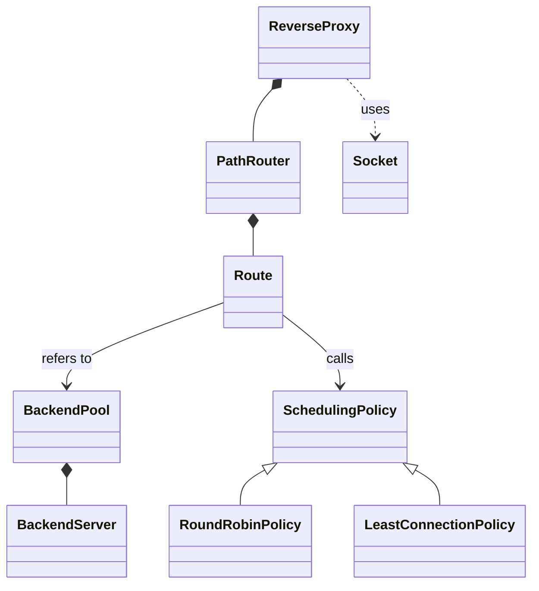

# Learning the Small Reverse Proxy

The aim is to understand the code well enough to explain and change it.
This guide describes the simplified version from 27 October 2026.

## 1. Start with the objects

Read src/main.cpp first. It creates two BackendPool objects, adds servers to them,
creates a policy for each pool and connects them to one ReverseProxy.

These are ordinary stack objects. No factory or dependency-injection framework is
involved. They remain alive while proxy.run() is running.

| Class | One responsibility | Useful concept |
| --- | --- | --- |
| BackendServer | Store the state of one server | Encapsulation |
| BackendPool | Store a collection of servers | Composition |
| SchedulingPolicy | Declare a server-selection operation | Abstract class |
| RoundRobinPolicy | Take turns between servers | Inheritance |
| LeastConnectionPolicy | Select the server with the lowest count | Inheritance |
| PathRouter | Find the pool and policy for a path | Association |
| ReverseProxy | Coordinate one request and response | Composition |
| Socket | Send/receive bytes and close a connection | Resource ownership |

HttpRequest is a small struct containing a method and target. It carries data;
it does not need a class hierarchy.

## 2. Encapsulation: BackendServer

The host, port and active connection count are private. Public
methods let the rest of the program use the state without changing fields directly.

The constructor rejects an empty host or invalid port. decrementConnections()
does not let the count go below zero. These checks protect the meaning of the
object's state and are simple enough to explain.

There is no health flag. Each configured server can be selected, even if it has
stopped. A failed connection produces a 502 response for that request.

## 3. Composition: BackendPool

BackendPool contains vector<BackendServer>. Adding a server copies it into the
pool. There is one collection, not separate lists of owning and borrowed pointers.

getBackend(index) returns a reference to the stored object. Changes made through
that reference affect the object inside the pool. The vector's at() reports an
invalid index instead of allowing an out-of-bounds access.

An important trade-off: growing a vector can move its elements. Configure pools
before run() and do not keep selected-server pointers across pool changes.
The current proxy uses a selected pointer only during one request.

## 4. Inheritance and polymorphism

SchedulingPolicy contains the pure virtual function:

~~~cpp
virtual BackendServer* selectBackend(BackendPool& pool) = 0;
~~~

It is an abstract class, so we create one of its derived classes.
Both policy classes override the same function.

A Route stores a SchedulingPolicy pointer. The proxy calls:

~~~cpp
BackendServer* backend = route->policy->selectBackend(*route->pool);
~~~

The actual policy object decides which implementation runs. This is runtime
polymorphism. Changing the policy does not require changing handleClient().

The base destructor is virtual so deleting a derived object through a base
pointer would call the correct destructor. The current setup uses stack objects,
but this is still the appropriate declaration for this interface.

## 5. Trace the algorithms

For round robin with servers A and B:

| Call | nextIndex before selection | Selected | nextIndex afterward |
| --- | --- | --- | --- |
| 1 | 0 | A | 1 |
| 2 | 1 | B | 0 |
| 3 | 0 | A | 1 |

The modulo operator wraps the index around. Each call selects one server and
advances the index. An empty pool returns nullptr. Give each pool its own policy
object and finish configuring the pool before serving requests.

For least connections, use counts A=3, B=1, C=2. Walk through every server and keep
the one with the smallest count seen so far. The result is B. Ties keep the first
server in the pool.

In the live program, requests are sequential. The selected server's count becomes
one while forwarding and returns to zero on success or failure. As a result,
least connections normally sees ties. Demonstrate the difference using
tests/scheduling/scheduling_policy_test.cpp, which sets up unequal counts.

For a focused test run:

~~~bash
ctest --test-dir out/oop-tests -R SchedulingPolicyTest -V
ctest --test-dir out/oop-tests -R LeastConnectionPolicyTest -V
~~~

Each route gets its own policy object so /static requests do not advance /api's
round-robin position.

## 6. Routing and object lifetimes

A Route contains a prefix, a pointer to a pool and a pointer to a policy.
main owns the pool and policy; the route only refers to them. This is association,
not ownership.

PathRouter scans routes in the order they were added and returns the first match.
For nested routes, add /api/admin before /api. A root route / should be added last.
Duplicate prefixes follow the same rule: the first one wins.
The query part does not affect routing, but remains in the forwarded target.

ReverseProxy contains its PathRouter directly, which is composition.
Keeping the main-owned objects alive while run() executes makes the borrowed
references valid.

## 7. Trace one real request

For GET /api/id:

1. ReverseProxy accepts a client and collects the request headers.
2. parseRequest reads the method and target from the first line.
3. PathRouter finds the /api route.
4. That route's policy chooses a BackendServer from its pool.
5. forwardRequest opens a backend connection and sends a fresh GET.
6. It reads the response until the backend closes the connection.
7. The proxy sends that response to the client and closes the client connection.

handleClient() increments the chosen server's connection count before forwarding
and decrements it after the try/catch. Both success and failure reach the same
decrement. forwardRequest() only sends and receives data; errors are logged with
the backend address by handleClient().

GET is the supported operation. Browser headers and request bodies are not copied.
The included Python backend returns a short body and closes its connection.
The proxy rejects an empty backend reply, but otherwise trusts its HTTP format.

An unknown route returns 404. A method other than GET returns 405.
An empty pool returns 503. A stopped backend produces 502 for requests
selected for that server. There is no automatic retry.

## 8. What to understand about sockets

You do not need to present socket internals as the main topic. Understand these
four operations: listen, accept, connect and send/receive.

The small Socket class keeps the operating-system descriptor private. Its
destructor closes the descriptor. Copying is disabled because two owners should
not close the same connection. A move constructor transfers ownership when a
function returns a Socket.

sendAll uses a loop because one send may write only part of a message.
The request and response readers also use loops because data may arrive in pieces.
These are necessary for a working demo, not optional advanced features.

Five-second socket timeouts avoid waiting forever on a completely silent peer.
They apply per blocking operation. A peer that sends occasional bytes can keep an
exchange open longer than five seconds. Buffers have small fixed limits.

The code does not contain poll loops, event scheduling, DNS resolution or custom
shutdown signals. Ctrl+C terminates the process, and the operating system releases
its descriptors; this is different from normal scope-based destruction.

## 9. Small exercises

- Add another local server to the API pool and show a three-server rotation.
- Stop one backend and explain why every other API request returns 502.
- Replace the API policy object with LeastConnectionPolicy and explain the ties.
- Add a route and trace which pool handles it.
- Explain why returning nullptr is useful when a pool is empty.

For each exercise, predict the output, make the change, run the relevant test or
demo, then explain what changed. Keep temporary demonstrations out of the default
configuration when finished.

## 10. Presentation questions

| Question | Answer |
| --- | --- |
| Why use classes? | Each class groups state and behavior around one clear job. |
| Why not inherit everything from one base class? | Pools, routes and sockets do different jobs. Only the scheduling algorithms share an interchangeable operation. |
| Where is polymorphism? | A call through SchedulingPolicy* invokes the selected derived policy. |
| What does the pool own? | Copies of BackendServer objects in its vector. |
| Are stopped servers skipped? | No. Every configured server stays in rotation. |
| Is least connections useful during this live demo? | It demonstrates the algorithm; sequential requests usually make all counts zero. |
| Why no threads? | The current learning goal is the object design and a traceable request flow. |
| What is outside scope? | General HTTP compatibility, POST, caching, concurrency and deployment. |
